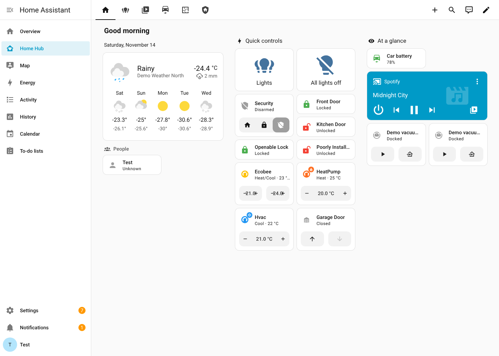
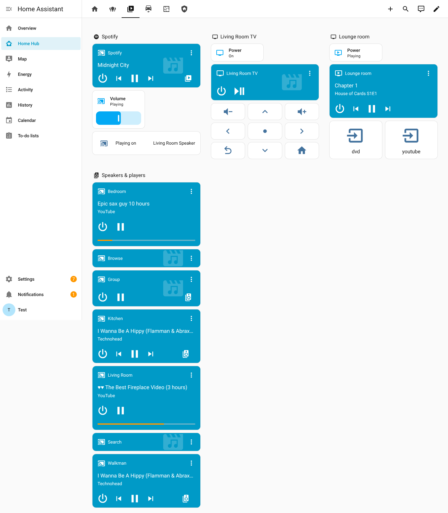
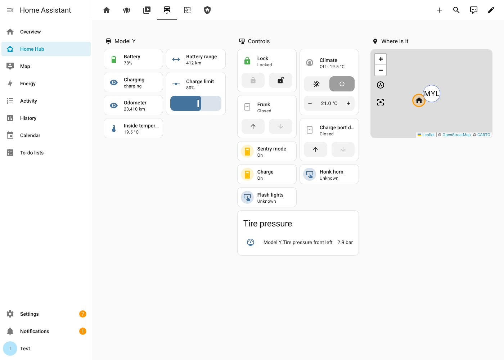

# Home Hub: a Home Assistant dashboard that builds itself

One command looks at everything in your Home Assistant (rooms, lights, TVs, Spotify,
Tesla, thermostats, locks, cameras, vacuums) and builds a clean dashboard with six tabs.
It **backs up your current setup first**, and one command puts everything back.

| Tab | What's on it |
| --- | --- |
| **Home** | Greeting and date, weather, who's home, quick controls (all lights off, locks, thermostats, garage, scenes), car battery, what's playing on Spotify, vacuum |
| **Lights** | One section per room with brightness sliders and a "Room off" button, plus fans and smart plugs |
| **Media** | Spotify player with volume and "Playing on" device; each TV with power, playback, a **remote D-pad** (up/down/left/right/OK, back, home, volume) and input buttons; all other speakers |
| **Car** | Tesla battery and range, charging, charge-limit slider, lock, climate, frunk/charge port, sentry, honk/flash, tire pressure, and a map of where the car is |
| **Rooms** | A card per room (temperature, lights, motion), your floor plan with tap-to-toggle lights, robot-vacuum maps |
| **Climate & Security** | Thermostats, room temperatures, alarm, locks, doors/windows/motion, cameras |

Tabs only appear when you have something for them, and nothing needs HACS or custom cards.





*(Screenshots are from Home Assistant's demo devices plus a simulated Tesla, Spotify and Google TV.)*

## What it changes, and what it doesn't

- It **adds a new dashboard** called **Home Hub** (in the sidebar, at `/home-hub`).
  Your existing Overview and other dashboards are **not modified**.
- Before installing it saves a copy of every dashboard to `backups/<date-time>/`, and asks
  Home Assistant to make a **full system backup** (Settings > System > Backups).
- It does not change devices, automations, integrations or settings.

## Run it (about 5 minutes)

You need any computer on your home network with Python 3.9 or newer (Mac and Linux have it;
on Windows install it from python.org). Nothing else to install.

1. **Make a token.** In Home Assistant click your name (bottom left) > **Security** tab >
   **Long-lived access tokens** > **Create token**. Name it "Home Hub" and copy it.
2. **Get this folder** onto that computer (download the repo as a ZIP from GitHub and unzip it).
3. Open a terminal in the `home-dashboard` folder and run:

   ```bash
   python3 ha_dashboard.py preview     # optional: see what it finds, changes nothing
   python3 ha_dashboard.py install
   ```

   It asks for your Home Assistant address (just press Enter for
   `http://homeassistant.local:8123`) and the token.
4. Open **Home Hub** in the sidebar. To make it your start page: Settings > Dashboards >
   Home Hub > ⋮ > **Set as default on this device**.

After install it prints a short report (also saved to `output/report.md`) listing what it
found, anything missing (e.g. "add the Spotify integration"), and **devices Home Assistant
has spotted on your network but you haven't set up yet**. Add those, then just run
`install` again: it rebuilds Home Hub with the new devices.

## Undo

```bash
python3 ha_dashboard.py restore
```

Restores every dashboard from the **first** backup (your setup before Home Hub existed) and
removes Home Hub. Running `install` more than once never changes which backup counts as the
original. To restore a different backup: `python3 ha_dashboard.py restore --from backups/<folder>`.
For a total rollback, use the full system backup under Settings > System > Backups.

## Options

```bash
# Leave rooms off the dashboard (repeatable), e.g. a home office
python3 ha_dashboard.py install --exclude-area "Office"

# Floor plan: put floorplan.png in Home Assistant's config/www folder, then
python3 ha_dashboard.py install --floorplan /local/floorplan.png
# Light icons are placed in a grid; drag them onto the right rooms in the dashboard editor.

python3 ha_dashboard.py report            # just the report
python3 ha_dashboard.py backup            # just a backup
python3 ha_dashboard.py install --no-full-backup
```

Skip the prompts by setting `HA_URL` and `HA_TOKEN` environment variables.
If your HA uses HTTPS with a self-signed certificate, also set `HA_INSECURE_TLS=1`.

## Getting your devices into Home Assistant

The dashboard can only show what Home Assistant knows about. Settings > Devices & services > **Add integration**:

| Device | Integration |
| --- | --- |
| Tesla | **Tesla Fleet** (official, free) or **Tessie** / **Teslemetry** (paid, much easier setup) |
| Spotify | **Spotify** (Premium needed to control playback) |
| Google TV / Android TV / Chromecast with Google TV | **Android TV Remote** (gives the D-pad) and **Google Cast** |
| Samsung TV | **Samsung Smart TV** |
| LG TV | **LG webOS TV** |
| Apple TV | **Apple TV** |
| Roku | **Roku** |
| Sony TV | **Sony Bravia TV** |
| Robot vacuum maps | **Roborock**, **Ecovacs**, **Dreame** (map shows up as an image entity) |

Most TVs, speakers and Hue/smart plugs on your Wi-Fi show up automatically under
**Discovered**. Give each device a room (Settings > Devices & services > Devices > pick device >
Area) so it lands in the right section of the Lights and Rooms tabs.

## Files

- `ha_dashboard.py` – backup, build, install, restore, report
- `ha_client.py` – tiny Home Assistant WebSocket client (standard library only)
- `backups/`, `output/` – created when you run it; stay on your computer (git-ignored)
